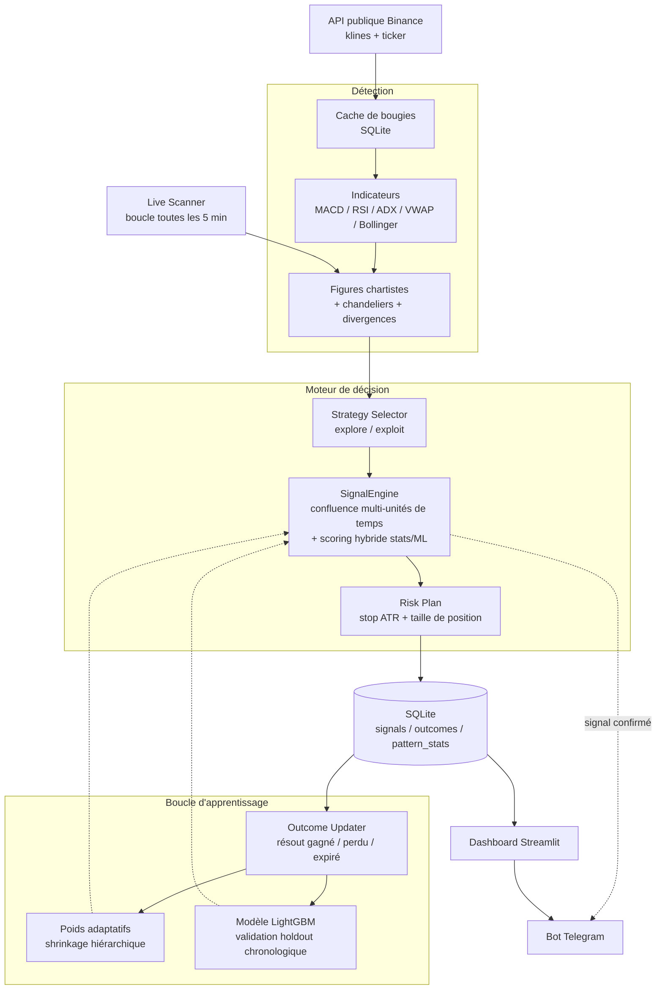
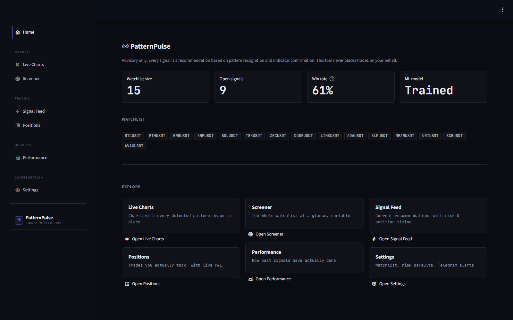
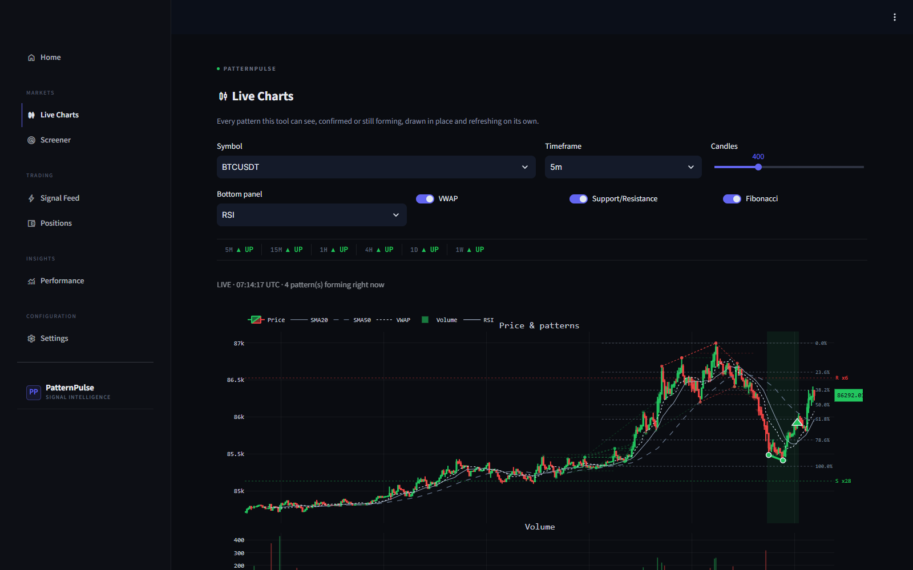
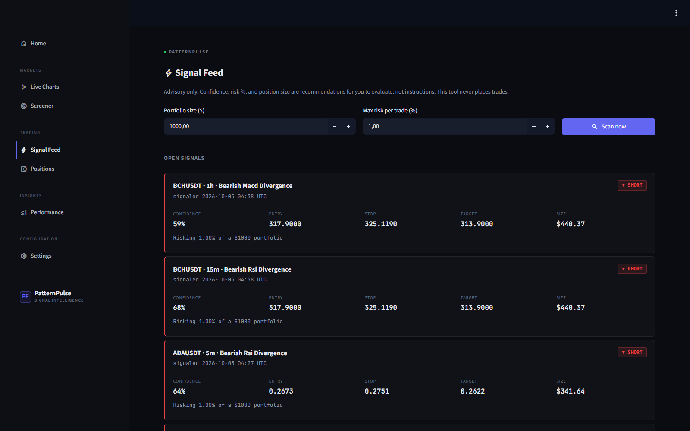
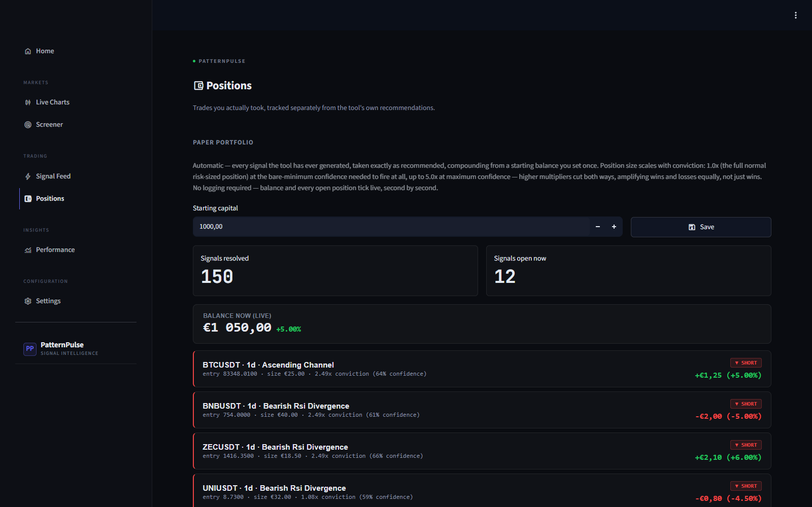

<p><em>Read this document in English: <a href="README.md">README.md</a></em></p>

# PatternPulse

**Outil d'aide à la décision pour l'analyse technique crypto. N'exécute jamais de trade, ne constitue pas un conseil financier.**

> ## Avertissement
> PatternPulse est un outil d'aide à la décision. Il n'exécute jamais de trade, sur aucun compte, à aucun moment, et ne constitue en aucun cas un conseil financier. Toute décision reste entièrement la responsabilité de l'utilisateur. Les cryptomonnaies sont des actifs volatils et risqués.

PatternPulse est un projet personnel : il surveille en continu un panier de cryptomonnaies sur Binance, sur plusieurs unités de temps, détecte des figures chartistes et des patterns de chandeliers, les confirme avec des indicateurs techniques, puis calcule un score de confiance confronté à ce qui s'est réellement passé ensuite. Il est construit pour démontrer une boucle d'apprentissage honnête de bout en bout, pas pour promettre des gains de trading.

---

## À quoi sert ce projet

PatternPulse surveille des données de marché publiques Binance (aucune clé API requise) sur plusieurs unités de temps simultanément, détecte des figures chartistes et des chandeliers, les confirme avec des indicateurs (MACD, RSI, volume, ADX, VWAP, et plus), puis produit un score de confiance ainsi qu'un plan de risque (stop, cible, taille de position suggérée). Chaque signal est ensuite suivi jusqu'à sa résolution réelle (gagné, perdu ou expiré), ce qui permet au système d'ajuster sa confiance au fil du temps en fonction de résultats réels, pas seulement de ses propres prédictions.

---

## Fonctionnalités

**Détection**
- Scan multi-symboles sur les 6 unités de temps configurées (5m, 15m, 1h, 4h, 1d, 1w) sur données Binance publiques
- 55 types de patterns nommés distincts, répartis sur 35 techniques de détection : figures chartistes (double/triple top et bottom, tête-épaules, triangles, biseaux, canaux, drapeaux, fanion, cup and handle, rectangle, élargissement, bull/bear traps, rounding top/bottom) et patterns de chandeliers (doji, famille marteau, avalement, harami, marubozu, spinning top, tweezer, étoiles, patterns de continuation/retournement à trois bougies, et plus), ainsi que des détecteurs de divergence RSI et MACD. Certaines techniques (triangles, biseaux, canaux, divergences, famille marteau, et d'autres) détectent plusieurs variantes directionnelles, ce qui explique que le nombre de techniques soit inférieur au nombre de patterns nommés.
- Distinction entre un pattern "confirmé" et un pattern encore "en formation", avec suivi de progression en direct

**Confirmation et scoring**
- Confluence multi-unités de temps : un signal est renforcé ou atténué selon que l'unité de temps supérieure va dans le même sens
- Confirmation par indicateurs (MACD, RSI, volume, ADX, Stochastic, VWAP, squeeze Bollinger, regroupement de supports/résistances, retracement de Fibonacci)
- Score de confiance hybride : un taux de réussite statistique (shrinkage hiérarchique pattern, puis pattern+unité de temps, puis pattern+unité de temps+symbole) fusionné avec un classifieur LightGBM selon une pondération fixe de 40 % statistiques / 60 % ML, une fois que le modèle ML existe (voir "Boucle d'apprentissage" ci-dessous pour savoir à partir de quand)
- Ajustement par expectancy : un pattern avec un bon taux de réussite mais un mauvais rendement moyen est noté plus bas que ce que son seul taux de réussite suggérerait, et inversement

**Sélection de stratégie**
- Logique explore/exploit : une fois qu'un couple (pattern, symbole) a accumulé assez d'historique résolu pour être jugé (15 échantillons ou plus) et que son rendement moyen est négatif, il est automatiquement mis de côté pour la génération de nouveaux signaux, sans bloquer les combinaisons encore statistiquement jeunes
- Un plafond strict sur le nombre de signaux ouverts simultanément, pour que l'attention ne se dilue pas sur des centaines d'idées à la fois

**Gestion du risque (purement informative)**
- Stop basé sur l'ATR, cible issue de la géométrie propre au pattern, taille de position suggérée via un calcul en fractionnel fixe à partir d'une taille de portefeuille et d'un risque maximum par trade définis par l'utilisateur

**Boucle d'apprentissage**
- Chaque signal est résolu automatiquement (stop touché, cible touchée, ou expiré) par une tâche de fond qui s'exécute toutes les 5 minutes, avec une fenêtre de résolution adaptée à chaque unité de temps pour qu'un signal 5 minutes et un signal 1 heure reçoivent tous deux un temps réel comparable pour se réaliser
- Chaque résultat résolu met à jour immédiatement le taux de réussite statistique
- Une fois qu'au moins 300 résultats résolus existent (seuil configurable), un classifieur LightGBM est entraîné sur l'intégralité de l'historique. Il est automatiquement réentraîné depuis zéro chaque fois qu'environ 20 nouveaux résultats résolus se sont accumulés, vérifié sur ce même cycle de 5 minutes. L'entraînement utilise une séparation chronologique 80/20 (pas un mélange aléatoire) avec arrêt anticipé, et l'AUC hors échantillon obtenue est conservée et affichée dans le tableau de bord, pas cachée derrière un simple indicateur "entraîné : oui". La probabilité de gain prédite par le modèle est ensuite fusionnée avec le score statistique selon une pondération 60/40 (ML/statistiques) pour produire la confiance finale ; elle n'opère jamais seule et ne remplace jamais silencieusement le score statistique, et la sortie brute du modèle ML reste visible dans le détail de chaque signal.
- Un graphique de calibration vérifie si un niveau de confiance donné gagne réellement aussi souvent qu'il l'annonce

**Portefeuille fictif (paper trading)**
- Un compteur actif en permanence : "si j'avais suivi chaque signal depuis le début avec X unités monétaires de départ"
- Mise à jour live, seconde par seconde, côté client, sans rechargement de page
- La taille de position dépend de la confiance calibrée du signal, pas de sa confiance brute

**Interfaces**
- Dashboard Streamlit : Live Charts, Screener, Signal Feed, Performance (calibration, AUC de validation), Positions, Settings
- Bot Telegram : alertes sur les signaux confirmés, commandes `/subscribe`, `/watchlist`, `/status`

---

## Architecture



Quatre processus tournent en continu via `docker compose` : le scanner (détection et enregistrement des signaux), le résolveur d'issues (clôture des signaux et alimentation de la boucle d'apprentissage), le bot Telegram, et le dashboard Streamlit, tous partageant la même base SQLite (mode WAL).

---

## Technologies utilisées

| Domaine | Choix | Pourquoi |
|---|---|---|
| Langage | Python 3.12 | Un seul langage pour la récupération de données, la détection de patterns, le ML, le dashboard et le bot, ce qui garde toute la boucle d'apprentissage dans une seule base de code |
| Données de marché | `python-binance` (API publique) | Aucune clé API requise, données temps réel et historiques |
| Indicateurs techniques | `ta` | Pur Python, pas de dépendance TA-Lib compilée |
| Détection de figures | `scipy.signal` (extrema) et règles géométriques maison | Pas de binaire natif à installer |
| Machine learning | `lightgbm` | Rapide et robuste sur données tabulaires, wheels prêtes à l'emploi pour Windows et Linux |
| Dashboard | `streamlit` et `plotly` | Navigation multi-page native (`st.navigation`), graphiques interactifs |
| Bot | `python-telegram-bot` | Alertes et commandes interactives |
| Stockage | SQLite (SQL brut, mode WAL) | Simplicité, accès concurrent sûr entre les 4 processus |
| Déploiement | Docker Compose et nginx | 4 services en `restart: unless-stopped`, un seul reverse proxy exposé |

---

## Lancer le projet avec Docker

```bash
git clone <url-de-ce-dépôt>
cd patternpulse

cp .env.example .env
# Éditer .env : TELEGRAM_BOT_TOKEN est optionnel (requis seulement pour les
# alertes Telegram ; créez un bot via @BotFather sur Telegram pour l'obtenir).
# Les autres valeurs par défaut conviennent pour démarrer.

docker compose build
docker compose up -d
```

Le dashboard est ensuite accessible sur `http://localhost/`. Les logs :

```bash
docker compose logs -f scanner
docker compose logs -f outcome_updater
```

Pour un déploiement 24/7 sur votre propre VPS, voir [`DEPLOY.md`](DEPLOY.md).

**Note** : le dashboard ne comporte aucune authentification par défaut. Aucun fonds ni identifiant réel n'est jamais à risque (l'outil n'exécute aucun trade), mais gardez cela en tête si vous exposez une instance publiquement.

---

## Captures d'écran

**Accueil**

*Capture avec données de démonstration, pas de résultats réels.*

**Live Charts**


**Signal Feed**


**Positions (portefeuille fictif)**

*Capture avec données de démonstration, pas de résultats réels.*

---

## Limites connues

- **Aucune garantie de performance.** Toute métrique affichée par l'application en fonctionnement (taux de réussite, solde du portefeuille fictif, etc.) reflète l'historique réel de l'outil au moment où elle est consultée, mais reste soumise à une vraie variance statistique et ne dit rien des performances futures.
- Un bon taux de réussite n'implique pas une bonne expectancy (gain moyen contre perte moyenne). Le système essaie de corriger ce biais dans son scoring, mais c'est un sujet permanent, pas un problème définitivement résolu.
- Les données de marché proviennent exclusivement de l'API publique Binance. Certaines régions cloud (notamment les régions US) sont bloquées par Binance.
- Le portefeuille fictif est une simulation pédagogique à capital fictif, pas un suivi de trades réels.
- La fenêtre de résolution des signaux est adaptée à chaque unité de temps mais reste une heuristique à durée fixe ; des mouvements de marché atypiques peuvent être mal classés (par exemple, une expiration sans que le stop ni la cible n'aient jamais été touchés).
- Le modèle ML se réentraîne automatiquement, mais certaines combinaisons (pattern, unité de temps, symbole) restent statistiquement jeunes et s'appuient davantage sur le prior statistique général que sur leur propre historique.
- Démarrage à froid : le modèle LightGBM n'existe pas du tout tant qu'au moins 300 résultats résolus ne se sont pas accumulés. Avant ce seuil, chaque score de confiance est 100 % statistique, sans aucune contribution ML. Après ce seuil, la confiance est un mélange fixe de 40 % statistiques / 60 % ML, jamais du ML seul.
- Projet personnel, non audité pour un usage en production à grande échelle.

---

## Comment ce projet a été réalisé

Ceci est un projet personnel. J'ai défini le cahier des charges, les fonctionnalités et les arbitrages, piloté [Claude Code](https://claude.com/claude-code) d'Anthropic pour l'implémentation, et validé le résultat par des tests et par l'usage en conditions réelles.

---

## Licence

[MIT](LICENSE)
