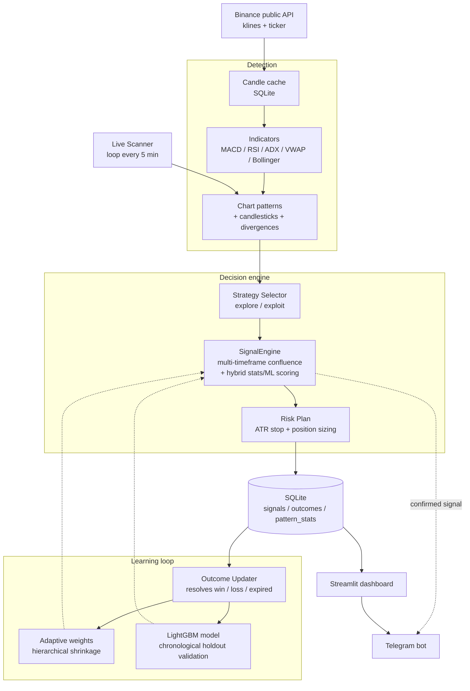

<p><em>Lire ce document en français : <a href="README.fr.md">README.fr.md</a></em></p>

# PatternPulse

**Advisory crypto technical-analysis tool. It never places trades and is not financial advice.**

> ## Advisory only
> PatternPulse is a decision-support tool. It never executes a trade, on any account, at any time, and it does not constitute financial advice. Every decision remains entirely the user's responsibility. Cryptocurrencies are volatile, risky assets.

PatternPulse is a personal project: it continuously scans a basket of cryptocurrencies on Binance across multiple timeframes, detects chart and candlestick patterns, confirms them against technical indicators, and scores each one with a confidence level that is checked against what actually happened afterward. It is built to demonstrate a complete, honest machine-learning feedback loop, not to promise trading profits.

---

## What this project does

PatternPulse watches public Binance market data (no API key required) across several timeframes at once, detects chart patterns and candlestick formations, confirms them with indicators (MACD, RSI, volume, ADX, VWAP, and more), and produces a confidence score plus a risk plan (stop, target, suggested position size). Every signal is then tracked until it actually resolves (win, loss, or expired), so the system's confidence adjusts over time based on real outcomes, not just its own predictions.

---

## Features

**Detection**
- Multi-symbol scanning across all 6 configured timeframes (5m, 15m, 1h, 4h, 1d, 1w) on public Binance data
- 55 distinct named pattern types across 35 detection techniques: chart patterns (double/triple top and bottom, head and shoulders, triangles, wedges, channels, flags, pennant, cup and handle, rectangle, broadening formation, bull/bear traps, rounding top/bottom) and candlestick patterns (doji, hammer family, engulfing, harami, marubozu, spinning top, tweezer, star patterns, three-candle continuation/reversal patterns, and more), plus RSI and MACD divergence detectors. Some techniques (triangles, wedges, channels, divergences, hammer family, and others) detect several directional variants, which is why the technique count is lower than the named-pattern count.
- Distinction between a "confirmed" pattern and one still "forming," with live progress tracking

**Confirmation and scoring**
- Multi-timeframe confluence: a signal is reinforced or weakened depending on whether the higher timeframe agrees
- Indicator confirmation (MACD, RSI, volume, ADX, Stochastic, VWAP, Bollinger squeeze, support/resistance clustering, Fibonacci retracement)
- Hybrid confidence score: a statistics-based win rate (hierarchical shrinkage across pattern, then pattern+timeframe, then pattern+timeframe+symbol) blended with a LightGBM classifier at a fixed 40% statistics / 60% ML weighting, once the ML model exists (see "Learning loop" below for when that is)
- Expectancy-aware adjustment: a pattern with a good win rate but a poor average return is scored lower than win rate alone would suggest, and vice versa

**Strategy selection**
- Explore/exploit logic: once a (pattern, symbol) combination has enough resolved history to judge (15+ samples) and its average return is negative, it is automatically benched from generating new signals, without blocking combinations that are still statistically young
- A hard cap on how many signals can be open at once, so attention does not dilute across hundreds of simultaneous ideas

**Risk management (informational only)**
- ATR-based stop distance, target from the pattern's own geometry, suggested position size from a fixed-fractional risk calculation based on a user-set portfolio size and max risk per trade

**Learning loop**
- Every signal is automatically resolved (stop hit, target hit, or expired) by a background job that polls every 5 minutes, with a resolution window scaled per timeframe so a 5-minute signal and a 1-hour signal both get a comparable amount of real time to play out
- Each resolved outcome updates the statistics-based win rate immediately
- Once at least 300 resolved outcomes exist (configurable), a LightGBM classifier is trained on the complete historical dataset. It is automatically retrained from scratch every time roughly 20 new resolved outcomes accumulate, checked on the same 5-minute poll cycle. Training uses a chronological 80/20 holdout (not a random shuffle) with early stopping, and the resulting out-of-sample AUC is persisted and surfaced in the dashboard, not hidden behind a simple "trained: yes" flag. The model's predicted win probability is then blended with the statistics-based score at a 60/40 weighting (ML/statistics) to produce the final confidence; it never operates alone or silently overrides the statistical score, and the raw ML output stays visible in each signal's detail.
- A calibration chart tracks whether a given confidence bucket actually wins as often as it claims

**Paper portfolio**
- An always-on counter: "if I had followed every signal since the start with X currency units"
- Live, second-by-second updates on the client side, with no page reload
- Position size scales with the signal's calibrated confidence, not its raw confidence

**Interfaces**
- Streamlit dashboard: Live Charts, Screener, Signal Feed, Performance (calibration, validation AUC), Positions, Settings
- Telegram bot: alerts on confirmed signals, `/subscribe`, `/watchlist`, `/status` commands

---

## Architecture



Four processes run continuously under `docker compose`: the scanner (detection and signal logging), the outcome resolver (closing signals and feeding the learning loop), the Telegram bot, and the Streamlit dashboard, all sharing the same SQLite database (WAL mode).

---

## Technology stack

| Area | Choice | Why |
|---|---|---|
| Language | Python 3.12 | Single language across data fetching, pattern detection, ML, dashboard, and bot, which keeps the whole learning loop in one codebase |
| Market data | `python-binance` (public API) | No API key required, real-time plus historical data |
| Technical indicators | `ta` | Pure Python, no compiled TA-Lib dependency |
| Pattern detection | `scipy.signal` (extrema) plus hand-written geometric rules | No native binary to install |
| Machine learning | `lightgbm` | Fast and robust on tabular data, prebuilt wheels for Windows and Linux |
| Dashboard | `streamlit` plus `plotly` | Native multi-page navigation (`st.navigation`), interactive charts |
| Bot | `python-telegram-bot` | Alerts and interactive commands |
| Storage | SQLite (raw SQL, WAL mode) | Simplicity, safe concurrent access across the 4 processes |
| Deployment | Docker Compose plus nginx | 4 services with `restart: unless-stopped`, a single exposed reverse proxy |

---

## Running it with Docker

```bash
git clone <this-repository-url>
cd patternpulse

cp .env.example .env
# Edit .env: TELEGRAM_BOT_TOKEN is optional (only needed for Telegram alerts;
# create a bot via @BotFather on Telegram to get one). The other defaults are
# fine to get started.

docker compose build
docker compose up -d
```

The dashboard is then available at `http://localhost/`. Logs:

```bash
docker compose logs -f scanner
docker compose logs -f outcome_updater
```

For a 24/7 deployment on your own VPS, see [`DEPLOY.md`](DEPLOY.md).

**Note**: the dashboard has no authentication by default. No real funds or credentials are ever at risk (the tool never executes trades), but keep this in mind if you expose an instance publicly.

---

## Screenshots

**Home**

*Screenshot with demo data, not real trading results.*

**Live Charts**


**Signal Feed**


**Positions (paper portfolio)**

*Screenshot with demo data, not real trading results.*

---

## Known limitations

- **No performance guarantee.** Any metric the running application shows you (win rate, paper-portfolio balance, and so on) reflects the tool's real history at the moment you look at it, but is subject to real statistical variance and says nothing about future performance.
- A good win rate does not imply good expectancy (average win versus average loss). The system tries to correct for this in its scoring, but it is an ongoing concern, not a solved problem.
- Market data comes exclusively from the public Binance API. Some cloud regions (notably US regions) are blocked by Binance.
- The paper portfolio is an educational simulation with fictional capital, not a record of real trades.
- The signal resolution window is scaled per timeframe but is still a fixed-time heuristic; unusual market moves can be misclassified (for example, expiring without the stop or target ever being touched).
- The ML model retrains automatically, but some (pattern, timeframe, symbol) combinations remain statistically young and rely more on the broader statistical prior than on their own history.
- Cold start: the LightGBM model does not exist at all until at least 300 resolved outcomes have accumulated. Before that point, every confidence score is 100% statistics-based, with no ML contribution. After that point, confidence is a fixed 40% statistics / 60% ML blend, never ML alone.
- This is a personal project and has not been audited for large-scale production use.

---

## How this project was built

This is a personal project. I defined the requirements, the features, and the tradeoffs, directed [Claude Code](https://claude.com/claude-code) from Anthropic for the implementation, and validated the result through testing and real-world use.

---

## License

[MIT](LICENSE)
